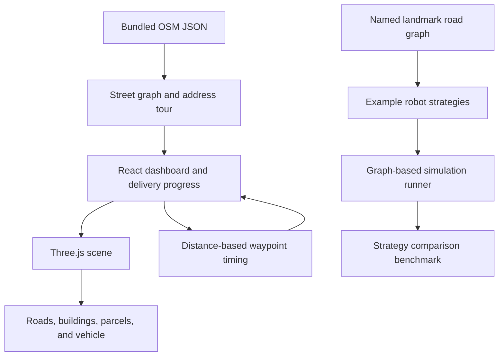

# RouteWise

**A road-network delivery simulation for exploring route planning in Paterson, New Jersey.**

RouteWise combines a React dashboard with a Three.js city scene. Start, pause,
or reset a delivery run; follow a Kenney 3D delivery car along a computed tour
of 123 address-tagged locations; and watch completed parcels appear beside
their destination buildings.

The interesting engineering is in how the scene route is produced: an
OpenStreetMap snapshot is transformed into a connected street graph, delivery
stops are snapped onto that graph, shortest road paths supply pairwise
distances, and a nearest-neighbor TSP tour is improved with 2-opt. The car
animates between route coordinates at distance-based timing.

> **Scope:** This is an educational visualization, not a navigation system.
> Address buildings are modeled for the scene, and disconnected street
> components may be joined with synthetic straight connectors. The route
> should not be used to guide real vehicles or pedestrians.

## Contents

- [Features](#features)
- [How the dashboard works](#how-the-dashboard-works)
- [Architecture](#architecture)
- [Technologies](#technologies)
- [Getting started](#getting-started)
- [Commands and tests](#commands-and-tests)
- [Project layout](#project-layout)
- [Data, assets, and attribution](#data-assets-and-attribution)
- [Limitations](#limitations)

## Features

- A 3D view of downtown Paterson streets, modeled buildings, trees, street
  furniture, and a delivery vehicle.
- A fixed, closed tour visiting 123 address-tagged delivery stops.
- Nearest-neighbor tour construction followed by a 2-opt improvement using
  shortest-path distances on the street graph.
- Distance-scaled robot travel time, smoothed vehicle heading, front-wheel
  steering, and wheel rotation.
- Start, pause, and reset controls, with delivery progress and a parcel queue.
- Delivered parcel boxes placed beside their addressed buildings.
- An orbitable, zoomable camera that follows the vehicle during movement.

## How the dashboard works

1. [`src/simulation/paterson-osm-data.json`](./src/simulation/paterson-osm-data.json)
   provides the bundled address and street-way snapshot.
2. [`src/simulation/paterson-route.js`](./src/simulation/paterson-route.js)
   projects geographic coordinates into a local planar coordinate system,
   splits road crossings, prunes dangling branches, connects remaining graph
   components, and snaps delivery locations to street edges.
3. Dijkstra shortest-path trees provide road distances between the depot and
   each delivery stop. A nearest-neighbor ordering is then improved with the
   reusable 2-opt implementation in
   [`src/algorithms/two-opt.js`](./src/algorithms/two-opt.js).
4. [`src/App.jsx`](./src/App.jsx) advances one route point at a time. A stop's
   route index determines when the corresponding parcel is marked delivered.
5. [`src/PatersonDistrictScene.jsx`](./src/PatersonDistrictScene.jsx) renders
   the street network and animated vehicle with Three.js. Its parcel placement
   logic uses [`src/simulation/scene-layout.js`](./src/simulation/scene-layout.js)
   to position each box beside its building while checking clearance.

The car model moves along the precomputed road route. It does not perform
on-the-fly pathfinding or collision avoidance. Scene rendering is requested
while the vehicle moves or the camera changes, rather than continuously while
the simulation is idle.

## Architecture



The project has two distinct simulation paths:

| Path | Purpose |
| --- | --- |
| Dashboard route | Displays the fixed OSM-derived tour of 123 addresses in the 3D scene. |
| Landmark simulator | Runs random, route-following, or smart strategies on a smaller named-location graph. |

The landmark simulator is used by the strategy benchmark and tests. It is not
the engine that chooses the dashboard's 123-address tour.

## Technologies

| Technology | Use |
| --- | --- |
| JavaScript (ES modules and JSX) | Application, route generation, simulation, and tests |
| React 19 | Dashboard and simulation controls |
| Three.js | 3D map, camera controls, and vehicle rendering |
| CSS | Dashboard and responsive layout |
| Vite | Development server and production build |
| Node.js test runner | Automated tests |
| ESLint | Static linting |
| OpenStreetMap | Bundled source for street and address data |

There is no backend service or database in this project; the map snapshot is
bundled with the frontend.

## Getting started

### Requirements

- Node.js 20.19+ or 22.12+
- npm

### Install and run

```sh
git clone <repository-url>
cd routewise
npm install
npm run dev
```

Open the local URL printed by Vite, usually
[`http://localhost:5173`](http://localhost:5173).

Use **Start simulation** to begin, **Pause simulation** to pause, and
**Reset run** to return to the first route point. Drag the 3D view to orbit
the camera and scroll to zoom.

## Commands and tests

| Command | Description |
| --- | --- |
| `npm run dev` | Start the Vite development server. |
| `npm run build` | Create a production build in `dist/`. |
| `npm run preview` | Serve the production build locally. |
| `npm run lint` | Run ESLint over the project. |
| `node --test` | Run the Node.js test suite. |

The tests cover road-graph validity, route connectivity, street adherence,
delivery-state transitions, robot strategies, parcel placement clearance,
animation timing, and benchmark output.

## Project layout

```text
src/
  algorithms/
    find-route.js          Breadth-first path search on the landmark graph
    two-opt.js             Closed-tour improvement helper
  benchmarks/
    compare-robots.js      Strategy outcome aggregation
  robots/
    random-robot.js        Random-neighbor strategy
    route-robot.js         Fixed landmark-route strategy
    smart-robot.js         Parcel-targeting strategy
  simulation/
    animation-settings.js  Geographic distance to animation duration
    parcels.js             Parcel creation and delivery helpers
    paterson-osm-data.json Bundled OSM addresses and street geometry
    paterson-route.js      OSM-derived street graph and delivery tour
    paterson-state.js      Landmark simulator state transitions
    road-graph.js          Named landmark adjacency graph
    run-simulation.js      Synchronous strategy runner
    scene-layout.js        Building, parcel, and obstacle clearance
  App.jsx                  Dashboard, controls, and delivery queue
  PatersonDistrictScene.jsx Three.js scene and vehicle animation
  App.css                  Dashboard and scene styles
  index.css                Shared base styles and theme
tests/
  benchmarks.test.js
  deliveries.test.js
  routes.test.js
```

## Data, assets, and attribution

### OpenStreetMap data

The project includes an offline OSM-derived snapshot. Its street and address
geometry is used to build the route and scene; the app does not fetch live map
data at runtime. OpenStreetMap data is available under the
[Open Database License (ODbL)](https://www.openstreetmap.org/copyright).

### Art assets

The delivery vehicle uses Kenney's `delivery.glb` from
[`kenney_car-kit`](./kenney_car-kit/). The roof tile comes from
[`kenney_tiny-city`](./kenney_tiny-city/). The included Kenney assets are
distributed under CC0; see the asset directories for their accompanying
license and source files.

## Limitations

- The map and route are a simulation, not a real-world navigation product.
- Building geometry is modeled for visualization rather than presented as
  authoritative building footprints.
- Synthetic connectors may be added between retained street-network
  components to make the tour traversable.
- The dashboard follows a precomputed single-robot tour; it does not implement
  live traffic, multi-vehicle coordination, or collision avoidance.
- The landmark strategy benchmark is separate from the dashboard route. Its
  current implementation does not guarantee identical randomized parcel
  layouts across strategies.
- The production build currently emits a warning that the Three.js scene
  bundle exceeds Vite's default 500 kB chunk-size advisory threshold.
# Routewise
